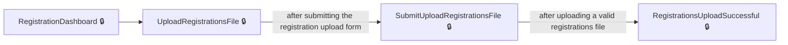
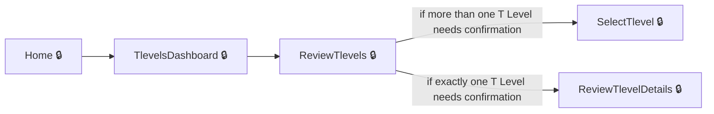
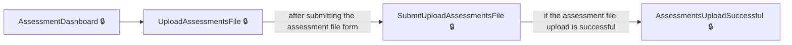

# User journeys: SkillsFundingAgency/tl-results-and-certification

Generated from `master/src`: 490 pages, 370 transitions, 3 journeys. 🔒 means sign-in is required. Dotted arrows return to a hub.

## Upload Learner Registrations Bulk File

Upload a registration file and receive confirmation or errors during bulk registration.

## Review and Confirm T Levels

Review and confirm T Levels for your provider, including reporting queries if information is incorrect.

Complete the sections in any order, returning to the hub.

## Submit Assessment File Upload

Upload assessment entries file for multiple learners and receive immediate confirmation or error details.

## Pages

| Page | Route | Sign-in | Purpose |
| --- | --- | --- | --- |
| `AccessibilityStatement` | `accessibility-statement` | No | Shows information about the website's accessibility features. |
| `Account.PostSignIn` | — | Yes | Directs the user to the appropriate dashboard or error page after signing in. |
| `AccountProfile` | `account-profile` | Yes | Lets the user view or update their account profile via an external profile URL. |
| `AddAddress` | `add-address` | Yes | Begins the process to add a new address for a provider. |
| `AddAddressCancel` | `add-postal-address-cancel` | Yes | Allows the user to cancel the addition of a new postal address. |
| `AddAddressCheckAndSubmit` | `add-postal-address-check-and-submit` | Yes | Allows the user to review and submit the new postal address information. |
| `AddAddressConfirmation` | `add-postal-address-confirmation` | Yes | Informs the user that the new postal address has been added successfully. |
| `AddAddressManually` | `add-address-manually/{isFromSelectAddress:bool?}/{isFromAddressMissing:bool?}` | Yes | Redirects the user to manually enter the new postal address details. |
| `AddAddressNotFound` | `add-postal-address-no-addresses-found` | Yes | Tells the user that no addresses were found for the entered postcode. |
| `AddAddressPostcode` | `add-postal-address-postcode/{showPostcode:bool?}/{isFromAddressMissing:bool?}` | Yes | Lets the user enter or confirm the postcode for the new postal address. |
| `AddAddressSelect` | `add-postal-address-select` | Yes | Lets the user select an address from a list found for the entered postcode. |
| `AddCoreAssessmentEntry` | `assessment-entry-add-core/{profileId}` | Yes | Lets the user add a core component assessment entry for a learner. |
| `AddCoreResult` | `select-core-result/{profileId}/{assessmentId}` | Yes | Lets the user add a result for a learner’s core assessment. |
| `AddIndustryPlacement` | `add-industry-placement/{profileId}` | Yes | Allows users to add an industry placement record for a learner. |
| `AddPostalAddressManual` | `add-postal-address-manual/{isFromSelectAddress:bool?}/{isFromAddressMissing:bool?}` | Yes | Lets the user manually enter the postal address details. |
| `AddProviderTlevels` | `add-additional-tlevels/{providerId}` | Yes | Lets the user add additional T-levels to a provider. |
| `AddRegistration` | `add-registration-unique-learner` | Yes | Starts the process for adding a new learner registration using a unique learner number. |
| `AddRegistrationAcademicYear` | `add-registration-academic-year/{isChangeMode:bool?}` | Yes | Allows the user to select the academic year for the new learner registration. |
| `AddRegistrationCheckAndSubmit` | `add-registration-check-and-submit` | Yes | Shows a summary of the registration details for the user to review and submit. |
| `AddRegistrationConfirmation` | `add-registration-confirmation` | Yes | Confirms successful submission of the learner registration. |
| `AddRegistrationCore` | `add-registration-core/{isChangeMode:bool?}` | Yes | Allows the user to select the core subject for the learner's registration. |
| `AddRegistrationDateofBirth` | `add-registration-date-of-birth/{isChangeMode:bool?}` | Yes | Allows the user to enter the learner's date of birth. |
| `AddRegistrationLearnersName` | `add-registration-learners-name/{isChangeMode:bool?}` | Yes | Allows the user to enter the learner's full name. |
| `AddRegistrationProvider` | `add-registration-provider/{isChangeMode:bool?}` | Yes | Allows the user to select the training provider for the learner. |
| `AddRegistrationSpecialismQuestion` | `add-registration-learner-decided-specialism-question/{isChangeMode:bool?}` | Yes | Asks whether the learner has chosen a specialism. |
| `AddRegistrationSpecialisms` | `add-registration-specialism/{isChangeMode:bool?}` | Yes | Allows the user to select one or more specialisms for the learner. |
| `AddRegistrationUln` | `add-registration-unique-learner-number/{isChangeMode:bool?}` | Yes | Allows the user to enter the learner's Unique Learner Number (ULN). |
| `AddSpecialismAssessmentEntry` | `assessment-entry-add-specialisms/{profileId}/{specialismsId}` | Yes | Lets the user add a specialism assessment entry for a learner. |
| `AddSpecialismResult` | `select-specialism-result/{profileId}/{assessmentId}` | Yes | Lets the user add a result for a learner’s specialism assessment. |
| `AddWithdrawnStatus` | `manage-learners-add-withdrawn-status/{profileId}` | Yes | Lets the user add a withdrawn status for a learner. |
| `AdminAddAppealOutcomeChangeGradeCore` | `admin/add-appeal-outcome-change-grade-core/{registrationPathwayId}/{assessmentId}` | Yes | Lets the admin edit appeal outcome grades for a learner's core assessment. |
| `AdminAddAppealOutcomeChangeGradeCoreClear` | `admin/add-appeal-outcome-change-grade-core-clear/{registrationPathwayId}/{assessmentId}` | Yes | Lets the admin clear current appeal outcome grade changes for a core assessment. |
| `AdminAddAppealOutcomeChangeGradeSpecialism` | `admin/add-appeal-outcome-change-grade-specialism/{registrationPathwayId}/{assessmentId}` | Yes | Lets the admin edit appeal outcome grades for a learner's specialism assessment. |
| `AdminAddAppealOutcomeChangeGradeSpecialismClear` | `admin/add-appeal-outcome-change-grade-specialism-clear/{registrationPathwayId}/{assessmentId}` | Yes | Lets the admin clear current appeal outcome grade changes for a specialism assessment. |
| `AdminAddCoreAppealOutcome` | `admin/add-appeal-outcome-core` | Yes | Allows an admin to add an outcome for a core appeal. |
| `AdminAddCoreAppealOutcomeClear` | `admin/add-appeal-outcome-core-clear` | Yes | Clears any cached data for adding a core appeal outcome before starting. |
| `AdminAddCoreRommOutcome` | `admin/add-romm-outcome-core` | Yes | Allows an admin to add an outcome for a core ROMM (Review of Marking and Moderation). |
| `AdminAddCoreRommOutcomeClear` | `admin/add-romm-outcome-core-clear` | Yes | Clears any cached data for adding a core ROMM outcome before starting. |
| `AdminAddNotification` | `admin/add-notification` | Yes | Allows an admin to create a new notification. |
| `AdminAddPathwayResult` | `admin/add-assessment-result-core/{registrationPathwayId}/{assessmentId}` | Yes | Lets the admin add a pathway (core) assessment result for a learner. |
| `AdminAddPathwayResultClear` | `admin/add-assessment-result-core-clear/{registrationPathwayId}/{assessmentId}` | Yes | Allows the admin to clear the entered pathway (core) result and return to the add result page. |
| `AdminAddPathwayResultReviewChanges` | `admin/review-changes-assessment-result-core` | Yes | Lets the admin review changes before confirming the addition of a pathway (core) assessment result. |
| `AdminAddProvider` | `admin/add-provider` | Yes | Lets the admin add a new provider. |
| `AdminAddRommOutcomeChangeGradeCore` | `admin/add-romm-outcome-change-grade-core/{registrationPathwayId}/{assessmentId}` | Yes | Allows an admin to change the grade while adding a ROMM outcome for a core. |
| `AdminAddRommOutcomeChangeGradeCoreClear` | `admin/add-romm-outcome-change-grade-core-clear/{registrationPathwayId}/{assessmentId}` | Yes | Clears any cached data for changing a ROMM outcome grade for a core. |
| `AdminAddRommOutcomeChangeGradeSpecialism` | `admin/add-romm-outcome-change-grade-specialism/{registrationPathwayId}/{assessmentId}` | Yes | Allows an admin to change the grade while adding a ROMM outcome for a specialism. |
| `AdminAddRommOutcomeChangeGradeSpecialismClear` | `admin/add-romm-outcome-change-grade-specialism-clear/{registrationPathwayId}/{assessmentId}` | Yes | Clears any cached data for changing a ROMM outcome grade for a specialism. |
| `AdminAddSpecialismAppealOutcome` | `admin/add-appeal-outcome-specialism` | Yes | Allows an admin to add an outcome for a specialism appeal. |
| `AdminAddSpecialismAppealOutcomeClear` | `admin/add-appeal-outcome-specialism-clear` | Yes | Clears any cached data for adding a specialism appeal outcome before starting. |
| `AdminAddSpecialismResult` | `admin/add-assessment-result-specialism/{registrationPathwayId}/{assessmentId}` | Yes | Lets the admin add a specialism assessment result for a learner. |
| `AdminAddSpecialismResultClear` | `admin/add-assessment-result-specialism-clear/{registrationPathwayId}/{assessmentId}` | Yes | Allows the admin to clear the entered specialism result and return to the add result page. |
| `AdminAddSpecialismResultReviewChanges` | `admin/review-changes-assessment-result-specialism` | Yes | Lets the admin review changes before confirming the addition of a specialism assessment result. |
| `AdminAddSpecialismRommOutcome` | `admin/add-romm-outcome-specialism` | Yes | Allows an admin to add an outcome for a specialism ROMM. |
| `AdminAddSpecialismRommOutcomeClear` | `admin/add-romm-outcome-specialism-clear` | Yes | Clears any cached data for adding a specialism ROMM outcome before starting. |
| `AdminAssessmentSeriesDateDetails` | `admin/assessment-series-date/{assessmentId}` | Yes | Lets an admin view details about a specific assessment series date. |
| `AdminChangeIndustryPlacement` | `admin/change-industry-placement/{registrationPathwayId}` | Yes | Lets the admin change the industry placement status for a learner. |
| `AdminChangeIndustryPlacementClear` | `admin/change-industry-placement-clear/{registrationPathwayId}` | Yes | Clears the industry placement change form and redirects to the change page. |
| `AdminChangePathwayResult` | `admin/change-assessment-result-core/{registrationPathwayId}/{assessmentId}` | Yes | Lets the admin change the result for the learner's core assessment. |
| `AdminChangePathwayResultClear` | `admin/change-assessment-result-core-clear/{registrationPathwayId}/{assessmentId}` | Yes | Clears the form for changing a pathway result and redirects to the change page. |
| `AdminChangePathwayResultReviewChanges` | `admin/change-assessment-result-core-review-changes` | Yes | Lets the admin review their changes to a learner's pathway result before saving. |
| `AdminChangeSpecialismResult` | `admin/change-assessment-result-specialism/{registrationPathwayId}/{assessmentId}` | Yes | Lets the admin change the result for the learner's specialism assessment. |
| `AdminChangeSpecialismResultClear` | `admin/change-assessment-result-specialism-clear/{registrationPathwayId}/{assessmentId}` | Yes | Clears the form for changing a specialism result and redirects to the change page. |
| `AdminChangeSpecialismResultReviewChanges` | `admin/change-assessment-result-specialism-review-changes` | Yes | Lets the admin review their changes to a learner's specialism result before saving. |
| `AdminCoreComponentAssessmentEntry` | `admin/add-assessment-entry-core/{registrationPathwayId}` | Yes | Lets the admin add a core assessment entry for a learner. |
| `AdminCoreComponentAssessmentEntryClear` | `admin/add-assessment-core-entry-clear/{registrationPathwayId}` | Yes | Clears the core assessment entry form and redirects back to entry. |
| `AdminDeleteNotification` | `admin/delete-notification/{notificationId}` | Yes | Allows an admin to view and confirm deletion of a notification. |
| `AdminDownloadCoreResultsDataLink` | `admin/download-core-results/{awardingOrganisationUkprn}/{fileId}` | Yes | Allows an admin to download core results data for an awarding organisation. |
| `AdminDownloadLearnerResultsByProvider` | `admin/download-learner-results-provider/{providerId}` | Yes | Lets the administrator download learner results for a specific provider. |
| `AdminDownloadLearnerResultsCsv` | `admin/download-learner-results-file-csv/{ukprn}` | Yes | Enables the administrator to download learner results as a CSV file for a provider. |
| `AdminDownloadLearnerResultsFindProvider` | `admin/download-learner-results-find-provider` | Yes | Allows the administrator to search for a provider before downloading learner results. |
| `AdminDownloadLearnerResultsFindProviderClear` | `admin/download-learner-results-find-provider-clear` | Yes | Lets the user clear their provider search filters when downloading learner results. |
| `AdminDownloadLearnerResultsPdf` | `admin/download-learner-results-file-pdf/{ukprn}` | Yes | Lets the user download a PDF file containing overall learner results for a specific provider. |
| `AdminDownloadLearnerResultsSubmitFindProvider` | `admin/download-learner-results-find-provider` | Yes | Lets the user submit a provider search when downloading learner results. |
| `AdminDownloadResultsRommsByAwardingOrganisation` | `admin/download-results-romms-awarding-organisation/{awardingOrganisationUkprn}` | Yes | Lets an admin download results and ROMMs reports for a selected awarding organisation. |
| `AdminDownloadRommsDataLink` | `admin/download-romms-data/{awardingOrganisationUkprn}/{fileId}` | Yes | Enables downloading ROMMs data for a specific awarding organisation. |
| `AdminDownloadSpecialismResultsDataLink` | `admin/download-specialism-results/{awardingOrganisationUkprn}/{fileId}` | Yes | Allows downloading specialism results data for an awarding organisation. |
| `AdminEditNotification` | `admin/edit-notification` | Yes | Allows an admin to view and edit an existing notification. |
| `AdminEditProvider` | `admin/edit-provider/{providerId}` | Yes | Lets the admin edit the details of an existing provider. |
| `AdminFindNotification` | `admin/find-notification/{pageNumber:int?}` | Yes | Lets the admin search for and view a list of notifications, optionally using filters. |
| `AdminFindNotificationClear` | `admin/find-notification-clear` | Yes | Lets the admin clear notification search filters and start a new search. |
| `AdminFindProvider` | `admin/find-provider` | Yes | Lets the admin search for a provider. |
| `AdminFindProviderClear` | `admin/find-provider-clear` | Yes | Allows the admin to clear any existing provider search criteria. |
| `AdminHome` | `admin/home` | Yes | Redirects the admin to the main home page. |
| `AdminIndustryPlacementSpecialConsiderationHours` | `admin/industry-placement-hours` | Yes | Lets the admin specify the hours for industry placement special consideration. |
| `AdminIndustryPlacementSpecialConsiderationReasons` | `admin/industry-placement-incomplete` | Yes | Lets the admin specify reasons for industry placement special consideration. |
| `AdminLearnerRecord` | `admin/learner-record/{pathwayid}` | Yes | Shows the detailed learner record for an admin. |
| `AdminNotificationDetails` | `admin/notification-details/{notificationId}` | Yes | Shows the details of a specific notification to the admin. |
| `AdminOccupationalSpecialisAssessmentEntry` | `admin/add-assessment-entry-specialism/{registrationPathwayId}/{specialismsId}` | Yes | Lets the admin add an occupational specialism assessment entry for a learner. |
| `AdminOccupationalSpecialisAssessmentEntryClear` | `admin/add-assessment-specialism-entry-clear/{registrationPathwayId}/{specialismsId}` | Yes | Clears the occupational specialism assessment entry form and redirects back to entry. |
| `AdminOpenPathwayAppeal` | `admin/open-appeal-core` | Yes | Allows an admin to open an appeal for a core pathway. |
| `AdminOpenPathwayAppealClear` | `admin/open-appeal-core-clear` | Yes | Clears any cached data for opening a core pathway appeal before starting. |
| `AdminOpenPathwayAppealReviewChanges` | `admin/review-changes-appeal-core/{registrationPathwayId}/{assessmentId}` | Yes | Allows an admin to review changes before confirming an open appeal for a core pathway. |
| `AdminOpenPathwayRomm` | `admin/open-romm-core` | Yes | Lets the admin open a ROMM (Review of Marking and Moderation) for a pathway core assessment. |
| `AdminOpenPathwayRommClear` | `admin/open-romm-core-clear` | Yes | Clears any cached data related to opening a ROMM for a pathway core assessment. |
| `AdminOpenPathwayRommReviewChanges` | `admin/review-changes-romm-core` | Yes | Lets the admin review the changes before confirming opening a ROMM for a pathway core assessment. |
| `AdminOpenSpecialismAppeal` | `admin/open-appeal-specialism` | Yes | Lets the admin open an appeal for a specialism assessment. |
| `AdminOpenSpecialismAppealClear` | `admin/open-appeal-specialism-clear` | Yes | Clears any cached data related to opening an appeal for a specialism assessment. |
| `AdminOpenSpecialismAppealReviewChanges` | `admin/review-changes-appeal-specialism/{registrationPathwayId}/{assessmentId}` | Yes | Lets the admin review the changes before confirming opening an appeal for a specialism assessment. |
| `AdminOpenSpecialismRomm` | `admin/open-romm-specialism` | Yes | Lets the admin open a ROMM for a specialism assessment. |
| `AdminOpenSpecialismRommClear` | `admin/open-romm-specialism-clear` | Yes | Clears any cached data related to opening a ROMM for a specialism assessment. |
| `AdminOpenSpecialismRommReviewChanges` | `admin/review-changes-romm-specialism` | Yes | Lets the admin review the changes before confirming opening a ROMM for a specialism assessment. |
| `AdminProviderDetails` | `admin/provider-details/{providerId}` | Yes | Displays details for a selected provider. |
| `AdminRequestReplacementDocument` | `admin/request-replacement-document/{registrationPathwayId}` | Yes | Lets the admin request a replacement document for a learner’s record. |
| `AdminReviewChangesAppealOutcomeCore` | `admin/add-appeal-outcome-change-grade-review-changes-core` | Yes | Lets the admin review the changes related to appeal outcome for a core before confirming. |
| `AdminReviewChangesAppealOutcomeSpecialism` | `admin/add-appeal-outcome-change-grade-review-changes-specialism` | Yes | Lets the admin review the changes related to appeal outcome for a specialism before confirming. |
| `AdminReviewChangesCoreAssessmentEntry` | `admin/review-changes-assesment-entry-core/{registrationPathwayId}` | Yes | Lets the admin review changes before submitting a new core component assessment entry for a learner. |
| `AdminReviewChangesIndustryPlacement` | `admin/review-changes-industry-placement/{pathwayId}` | Yes | Lets the admin review changes to a learner’s industry placement before they are submitted. |
| `AdminReviewChangesRommOutcomeCore` | `admin/add-romm-outcome-change-grade-review-changes-core` | Yes | Lets the admin review the changes related to ROMM outcome for a core before confirming. |
| `AdminReviewChangesRommOutcomeSpecialism` | `admin/add-romm-outcome-change-grade-review-changes-specialism` | Yes | Lets the admin review the changes related to ROMM outcome for a specialism before confirming. |
| `AdminReviewChangesSpecialismAssessmentEntry` | `admin/review-changes-assesment-entry-specialism/{registrationPathwayId}` | Yes | Lets the admin review changes before submitting a new specialism assessment entry for a learner. |
| `AdminReviewRemoveCoreAssessmentEntry` | `admin/review-remove-assessment-entry-core` | Yes | Lets the admin review the removal of a learner’s core assessment entry before confirming. |
| `AdminReviewRemoveSpecialismAssessmentEntry` | `admin/review-remove-assessment-entry-specialism/{registrationPathwayId}` | Yes | Lets the admin review the removal of a learner’s specialism assessment entry before confirming. |
| `AdminSearchChangeLog` | `admin/change-log/{pageNumber:int?}` | Yes | Displays a list of change log records for administrators to review. |
| `AdminSearchChangeLogClear` | `admin/change-log-clear` | Yes | Clears the search criteria for the change log and returns to the main change log page. |
| `AdminSearchLearnersRecords` | `admin/search-learner-records/{pageNumber:int?}` | Yes | Lets the admin search learner records, possibly with filters and paging. |
| `AdminSearchLearnersRecordsClear` | `admin/search-learner-records-clear` | Yes | Clears any applied search criteria or filters from learner search records for the admin. |
| `AdminSelectAwardingOrganisation` | `admin/select-awarding-organisation` | Yes | Lets an admin select an awarding organisation for further actions or downloads. |
| `AdminSelectAwardingOrganisationClear` | `admin/select-awarding-organisation-clear` | Yes | Clears selection and cached data for awarding organisation search. |
| `AdminSubmitChangeIndustryPlacement` | `admin/submit-change-industry-placement` | Yes | Lets the admin submit changes to a learner’s industry placement after review. |
| `AdminSubmitFindProvider` | `admin/find-provider` | Yes | Processes the provider search form and redirects to the provider's details if found. |
| `AdminSubmitSelectAwardingOrganisation` | `admin/select-awarding-organisation` | Yes | Allows the administrator to select an awarding organisation. |
| `AdminViewChangeAddPathwayResultRecord` | `admin/view-change-record/7/{changeLogId}` | Yes | Shows details of a change log record for adding a pathway result. |
| `AdminViewChangeAddSpecialismResultRecord` | `admin/view-change-record/8/{changeLogId}` | Yes | Shows details of a change log record for adding a specialism result. |
| `AdminViewChangeCoreAssessmentRecord` | `admin/view-change-record/3/{changeLogId}` | Yes | Shows details of a change log record for a core assessment. |
| `AdminViewChangeIPRecord` | `admin/view-change-record/2/{changeLogId}` | Yes | Shows details of a change log record for an Industry Placement change. |
| `AdminViewChangePathwayResultRecord` | `admin/view-change-record/9/{changeLogId}` | Yes | Shows details of a change log record for changing a pathway result. |
| `AdminViewChangeRemoveCoreAssessmentRecord` | `admin/view-change-record/5/{changeLogId}` | Yes | Shows details of a change log record for removing a core assessment. |
| `AdminViewChangeRemoveSpecialismAssessmentRecord` | `admin/view-change-record/6/{changeLogId}` | Yes | Shows details of a change log record for removing a specialism assessment. |
| `AdminViewChangeSpecialismAssessmentRecord` | `admin/view-change-record/4/{changeLogId}` | Yes | Shows details of a change log record for a specialism assessment. |
| `AdminViewChangeSpecialismResultRecord` | `admin/view-change-record/10/{changeLogId}` | Yes | Shows details of a change log record for changing a specialism result. |
| `AdminViewChangeStartYearRecord` | `admin/view-change-record/1/{changeLogId}` | Yes | Shows details of a change log record for a start year change. |
| `AdminViewOpenPathwayAppealRecord` | `admin/view-change-record/15/{changeLogId}` | Yes | Shows details of a change log record for an open pathway appeal. |
| `AdminViewOpenPathwayRommRecord` | `admin/view-change-record/11/{changeLogId}` | Yes | Shows details of a change log record for an open pathway ROMM. |
| `AdminViewOpenSpecialismAppealRecord` | `admin/view-change-record/16/{changeLogId}` | Yes | Allows an admin to view the details of an open specialism appeal change record. |
| `AdminViewOpenSpecialismRommRecord` | `admin/view-change-record/12/{changeLogId}` | Yes | Allows an admin to view the details of an open specialism ROMM change record. |
| `AdminViewPathwayAppealOutcomeRecord` | `admin/view-change-record/17/{changeLogId}` | Yes | Allows an admin to view the outcome of a pathway appeal change record. |
| `AdminViewPathwayRommOutcomeRecord` | `admin/view-change-record/13/{changeLogId}` | Yes | Allows an admin to view the outcome of a pathway ROMM change record. |
| `AdminViewSpecialismAppealOutcomeRecord` | `admin/view-change-record/18/{changeLogId}` | Yes | Allows an admin to view the outcome of a specialism appeal change record. |
| `AdminViewSpecialismRommOutcomeRecord` | `admin/view-change-record/14/{changeLogId}` | Yes | Allows an admin to view the outcome of a specialism ROMM change record. |
| `AllTlevelsReviewed` | `all-tlevels-reviewed` | Yes | Informs the user that all T Levels have been reviewed. |
| `AmendActiveRegistration` | `amend-active-registration/{profileId}/{changeStatusId:int?}` | Yes | Lets the user amend details of an active learner registration. |
| `AmendWithdrawRegistration` | `amend-withdrawn-registration/{profileId}/{changeStatusId:int?}` | Yes | Lets the user amend details of a withdrawn learner registration. |
| `AssessmentDashboard` | `assessment-entries` | Yes | Provides an overview and access to assessment entry features. |
| `AssessmentDetails` | `assessment-entry-learner-details/{profileId}` | Yes | Shows the details for a learner's assessment entries. |
| `AssessmentWithdrawnDetails` | `assessment-entries-learner-withdrawn/{profileId}` | Yes | Shows details for a withdrawn learner's assessment entry. |
| `AssessmentsDownloadData` | `assessments-download-data` | Yes | Displays download links for assessment entry data files. |
| `AssessmentsDownloadDataLink` | `download-assessments-data/{id}/{componentType}` | Yes | Lets the user download an assessment data file for a specified component. |
| `AssessmentsGeneratingDownload` | `assessments-generating-download` | Yes | Informs the user that their assessment data download request is being processed. |
| `AssessmentsNoRecordsFound` | `assessments-no-records-found` | Yes | Notifies the user that no assessment entry records were found for their export request. |
| `AssessmentsUploadSuccessful` | `assessment-entries-upload-confirmation` | Yes | Confirms that an assessment entries upload was successful and shows relevant statistics. |
| `AssessmentsUploadUnsuccessful` | `assessment-entries-upload-unsuccessful` | Yes | Shows information about an unsuccessful assessment entries upload and error details. |
| `CannotChangeAcademicYear` | `academic-year-cannot-change/{profileId}` | Yes | Shows that the academic year cannot be changed for the learner registration. |
| `ChangeAcademicYear` | `academic-year-change/{profileId}` | Yes | Allows the user to begin the process of changing a learner's academic year. |
| `ChangeAcademicYearConfirmation` | `academic-year-change-confirmation` | Yes | Shows confirmation after the academic year for a learner's registration has been changed. |
| `ChangeBackToActiveAOMessage` | `restore-learner-ao-message/{profileId}` | Yes | Shows information to the user after changing a withdrawn learner back to active status and not having notified the awarding organisation. |
| `ChangeBackToActiveStatus` | `restore-learner-ao/{profileId}` | Yes | Allows the user to reinstate a learner from withdrawn to active status. |
| `ChangeBackToActiveStatusHaveYouToldAwardingOrganisation` | `restore-learner-have-you-told-ao/{profileId}` | Yes | Asks the user if they have told the awarding organisation when reinstating a learner to active status. |
| `ChangeCoreResult` | `change-core-result/{profileId}/{assessmentId}` | Yes | Lets the user change a previously entered core result for a learner. |
| `ChangeRegistrationConfirmation` | `registration-details-change-confirmation` | Yes | Shows confirmation after a change to registration details has been completed. |
| `ChangeRegistrationCore` | `change-core/{profileId}` | Yes | Lets the user change the core subject in a learner's registration. |
| `ChangeRegistrationCoreQuestion` | `change-core-and-provider/{profileId}` | Yes | Asks the user if they want to change the core subject for a registration when the new provider does not offer the same core. |
| `ChangeRegistrationDateofBirth` | `change-registration-learners-date-of-birth/{profileId}` | Yes | Enables the user to change a learner's date of birth in their registration. |
| `ChangeRegistrationLearnersName` | `change-registration-learners-name/{profileId}` | Yes | Enables the user to change the learner's name in their registration. |
| `ChangeRegistrationProvider` | `change-registration-provider/{profileId}/{isback:bool?}` | Yes | Lets the user change the training provider in a learner's registration. |
| `ChangeRegistrationProviderAndCoreNeedToWithdraw` | `change-registration-provider-and-core-need-to-withdraw` | Yes | Informs the user that to change both provider and core, the registration needs to be withdrawn. |
| `ChangeRegistrationProviderNotOfferingSameCore` | `change-registration-provider-not-offering-core` | Yes | Informs the user that the new provider does not offer the same core subject. |
| `ChangeRegistrationSpecialismQuestion` | `change-registration-learner-decided-specialism-question/{profileId}` | Yes | Asks whether the learner has decided on their specialism for the registration. |
| `ChangeRegistrationSpecialisms` | `change-registration-select-specialism/{profileId}` | Yes | Lets the user select specialisms for the learner's registration. |
| `ChangeSpecialismRestriction` | `registration-specialism-change-restriction/{profileId}` | Yes | Displays restrictions on changing specialisms for a registration. |
| `ChangeSpecialismResult` | `change-specialism-result/{profileId}/{assessmentId}` | Yes | Lets the user change a previously entered specialism result for a learner. |
| `ChangeStartYear` | `admin/change-start-year/{registrationPathwayId}` | Yes | Lets the admin change the start year for a learner’s pathway. |
| `ChangeStartYearClear` | `admin/change-start-year-clear/{registrationPathwayId}` | Yes | Clears the cached change start year data for a learner before returning to the change page. |
| `ChangeWithdrawnStatusHaveYouToldAwardingOrganisation` | `manage-add-withdrawn-status-ao-message/{profileId}` | Yes | Allows the training provider to confirm if they have informed the awarding organisation when a learner's withdrawn status is being updated. |
| `ConfirmTlevel` | `confirm-tlevel` | Yes | Allows the user to confirm the details of a T Level. |
| `ConfirmedTlevels` | `confirmed-tlevels` | Yes | Shows the user the list of T Levels that have been confirmed. |
| `Contact` | `contact-us` | No | Provides contact information and a way for users to reach support. |
| `CookieDetails` | `cookie-details` | No | Explains details about the cookies used by the website. |
| `Cookies` | `cookies` | No | Gives information about the website's use of cookies. |
| `DeleteRegistration` | `delete-registration/{profileId}` | Yes | Allows the user to confirm deletion of a learner's registration. |
| `DownloadAssessmentEntriesDataFormatAndRulesGuide` | `tlevels-assessment-entries-data-format-and-rules` | No | Lets the user download the guide detailing data format and rules for assessment entries. |
| `DownloadAssessmentEntriesTemplate` | `tlevels-assessment-entries-template` | No | Lets the user download the template for submitting assessment entry data. |
| `DownloadLearnerOverallResultSlipsFile` | `download-learner-tlevel-result-slips-file/{profileId}` | Yes | Lets users download T Level result slips for a specific learner. |
| `DownloadOverallResultSlipsFile` | `download-tlevel-result-slips-file` | Yes | Allows users to download overall T Level result slips for all learners. |
| `DownloadOverallResultsFile` | `download-tlevel-results-file` | Yes | Allows users to download overall T Level results as a file. |
| `DownloadOverallResultsPage` | `download-tlevel-results` | Yes | Displays the page for downloading T Level results and result slips. |
| `DownloadRegistrationDataFormatAndRulesGuide` | `tlevels-registration-data-format-and-rules` | No | Lets the user download the guide detailing data format and rules for registrations. |
| `DownloadRegistrationDataTemplate` | `tlevels-registration-data-template` | No | Lets the user download the template for submitting registration data. |
| `DownloadRegistrationsData` | `download-registrations-data` | Yes | Lets the user download data about registrations for different academic years. |
| `DownloadRegistrationsDataFor` | `download-registrations-data-for` | Yes | Lets the user download registration data for a specific academic year. |
| `DownloadRegistrationsDataForLink` | `download-registrations-data-for/{id}` | Yes | Provides the actual download link for registration data based on file identifier. |
| `DownloadResultsDataFormatAndRulesGuide` | `tlevels-results-data-format-and-rules` | No | Lets the user download the guide detailing data format and rules for results entries. |
| `DownloadResultsTemplate` | `tlevels-results-template` | No | Lets the user download the template for submitting results data. |
| `DownloadRommDataFormatAndRulesGuide` | `tlevels-romm-data-format-and-rules` | No | Lets the user download the guide detailing data format and rules for ROMM (Review of Marking and Moderation) entries. |
| `DownloadRommDataTemplate` | `tlevels-romm-data-template` | No | Lets the user download the template for submitting ROMM entry data. |
| `DownloadWithdrawalsDataFormatAndRulesGuide` | `tlevels-withdrawals-data-format-and-rules` | No | Lets the user download the guide detailing data format and rules for withdrawals entries. |
| `DownloadWithdrawalsDataTemplate` | `tlevels-withdrawal-data-template` | No | Lets the user download the template for submitting withdrawal data. |
| `EntrySeries` | `assessment-entry-add-core/{profileId}` | Yes | Allows the user to opt in and add a core assessment entry for a learner. |
| `FindProvider` | `find-provider/{isback:bool?}` | Yes | Allows the user to search for a provider. |
| `Home` | `home` | Yes | Displays the main dashboard for navigation through the service's features. |
| `Home.Index` | — | No | Serves as the home page, and redirects authenticated users to their account area. |
| `IndustryPlacementsUploadSuccessful` | `upload-ip-file-success` | Yes | Shows a confirmation that the industry placements file upload was successful. |
| `IndustryPlacementsUploadUnsuccessful` | `ip-upload-unsuccessful` | Yes | Shows that the industry placements file upload was unsuccessful. |
| `IpCheckAndSubmit` | `industry-placement-check-your-answers` | Yes | Lets users review their industry placement data before submitting. |
| `IpCheckAndSubmitCancel` | `industry-placement-check-your-answers-cancel/{profileId}` | Yes | Enables users to cancel reviewing industry placement answers and returns them to the learner's record details. |
| `IpCompletion` | `industry-placement-completion/{profileId}/{isChangeMode:bool?}` | Yes | Allows the user to indicate the completion status of a learner's industry placement. |
| `IpSpecialConsiderationHours` | `industry-placement-special-consideration-hours/{isChangeMode:bool?}` | Yes | Lets the user enter the number of hours for special consideration in industry placement. |
| `IpSpecialConsiderationReasons` | `industry-placement-special-consideration-reasons/{isChangeMode:bool?}` | Yes | Lets the user select reasons for special consideration in industry placement. |
| `LearnerRecordDetails` | `learner-record-page/{profileId}` | Yes | Displays the detailed record for a specific learner, including their registration and status. |
| `ManagePostalAddress` | `manage-postal-address` | Yes | Displays and manages the current postal address for the provider. |
| `NoConfirmedTlevels` | `no-confirmed-tlevels` | Yes | Informs the user that there are no confirmed T Levels. |
| `NoQueriedTlevels` | `no-queried-tlevels` | Yes | Informs the user that there are no queried T Levels. |
| `PathwayNotEligibleForAcademicYearChange` | `pathway-not-eligible-for-academic-year-change/{profileId}` | Yes | Informs the user that the pathway is not eligible for an academic year change. |
| `PendingWithdrawalsDownloadDataLink` | `download-pending-withdrawals-data/{id}` | Yes | Lets the user download pending withdrawals data for registrations. |
| `PostalAddressMissing` | `postal-address-missing` | Yes | Informs the user that the postal address is missing and must be added for the statement of achievement. |
| `ProblemWithAssessmentsUpload` | `assessment-entries-file-upload-service-problem` | Yes | Informs the user about a problem with the assessment entries upload service. |
| `ProblemWithRegistrationsUpload` | `problem-with-registrations-upload` | Yes | Informs the user about a problem with uploading the registrations file. |
| `ProblemWithResultsUpload` | `results-file-upload-service-problem` | Yes | Informs the user of a problem with the results file upload. |
| `ProviderGuidance` | `provider-guidance` | Yes | Provides guidance information for training providers. |
| `ProviderTimeline` | `provider-timeline` | Yes | Shows a timeline related to the training provider activities. |
| `ProviderTlevelConfirmation` | `submit-successful` | Yes | Informs the user that T-levels have been successfully added to a provider. |
| `ProviderTlevels` | `provider-tlevels/{providerId}/{navigation:bool?}` | Yes | Displays the T-levels currently associated with a provider. |
| `PrsAddAppeal` | `post-results-add-appeal/{profileId}/{assessmentId}/{componentType}/{isBack:bool?}` | Yes | Lets the user start an appeal process for a selected post-results learner assessment. |
| `PrsAddAppealOutcome` | `post-results-add-appeal-outcome/{profileId}/{assessmentId}/{componentType}/{outcomeTypeId:int?}` | Yes | Lets the user specify the outcome of an appeal for a learner's assessment. |
| `PrsAddAppealOutcomeKnown` | `post-results-appeal-outcome-known/{profileId}/{assessmentId}/{componentType}/{outcomeKnownTypeId:int?}` | Yes | Lets the user record a known outcome for a post-results appeal. |
| `PrsAddRomm` | `post-results-add-romm/{profileId}/{assessmentId}/{componentType}/{isBack:bool?}` | Yes | Lets the user start a Review of Marking and Moderation (ROMM) request for a learner's assessment. |
| `PrsAddRommOutcome` | `post-results-add-romm-outcome/{profileId}/{assessmentId}/{componentType}/{outcomeTypeId:int?}` | Yes | Lets the user specify the outcome of a ROMM request for a learner's assessment. |
| `PrsAddRommOutcomeKnown` | `post-results-romm-outcome-known/{profileId}/{assessmentId}/{componentType}/{outcomeKnownTypeId:int?}` | Yes | Lets the user record a known outcome for a post-results ROMM request. |
| `PrsAppealCheckAndSubmit` | `post-results-appeal-check` | Yes | Lets the user review the appeal outcome before final submission. |
| `PrsAppealGradeChange` | `post-results-appeal-change-grade/{profileId}/{assessmentId}/{componentType}/{isAppealOutcomeJourney:bool?}/{isChangeMode:bool?}` | Yes | Lets the user change the learner's grade as part of an appeal outcome. |
| `PrsCancelAppealUpdate` | `post-results-cancel-appeal-update` | Yes | Lets the user cancel an appeal outcome update process. |
| `PrsCancelGradeChangeRequest` | `post-results-cancel-final-grade-change-request/{profileId}/{assessmentId}/{componentType}/{isResultJourney:bool?}` | Yes | Lets the user cancel a final grade change request for a learner's assessment. |
| `PrsCancelRommUpdate` | `post-results-cancel-ROMM-update` | Yes | Lets the user cancel a ROMM outcome update process. |
| `PrsGradeChangeRequest` | `post-results-final-grade-change-request/{profileId}/{assessmentId}/{componentType}` | Yes | Lets the user request a final grade change for a particular learner's assessment. |
| `PrsGradeChangeRequestConfirmation` | `post-results-final-grade-change-request-sent` | Yes | Shows confirmation that the final grade change request was submitted. |
| `PrsLearnerDetails` | `post-results-learners-grades/{profileId}` | Yes | Shows post-results grades and details for a specific learner. |
| `PrsNoResults` | `post-results-no-results/{profileId}` | Yes | Shows that no post-results are available for a specified learner. |
| `PrsRommCheckAndSubmit` | `post-results-romm-check` | Yes | Lets the user review and confirm the outcome for a ROMM (Review of Marking and Moderation) request. |
| `PrsRommGradeChange` | `post-results-romm-change-grade/{profileId}/{assessmentId}/{componentType}/{isRommOutcomeJourney:bool?}/{isChangeMode:bool?}` | Yes | Lets the user select and change the grade as the result of a ROMM request. |
| `PrsUlnWithdrawn` | `post-results-learner-withdrawn/{profileId}` | Yes | Shows that the learner is withdrawn and provides their post-results details. |
| `QueriedTlevels` | `queried-tlevels` | Yes | Shows the user the list of T Levels that have been queried. |
| `QueryServiceProblem` | `query-service-problem` | Yes | Informs the user there was a problem with the service while reporting a query about a T Level. |
| `QueryTlevelDetails` | `query-t-level/{id}/{isBackToConfirmed:bool?}` | Yes | Lets the user report an issue with a T Level's details. |
| `QueryTlevelSent` | `tlevel-query-sent` | Yes | Shows the confirmation that an issue report about a T Level was sent. |
| `RegistrationCancelledConfirmation` | `registration-deleted-confirmation` | Yes | Shows confirmation that the learner's registration has been deleted. |
| `RegistrationCannotBeDeleted` | `registration-cannot-be-deleted` | Yes | Informs the user that a registration cannot be deleted due to certain constraints. |
| `RegistrationCannotBeWithdrawn` | `registration-cannot-be-withdrawn` | Yes | Informs the user that a registration cannot be withdrawn due to certain constraints. |
| `RegistrationDashboard` | `registrations` | Yes | Provides an overview and access to different registration-related tasks. |
| `RegistrationDetails` | `search-for-registration-registration-details/{profileId}` | Yes | Shows the details for a specific learner's registration, including academic years and other registration information. |
| `RegistrationsDownloadData` | `registrations-download-data` | Yes | Displays available download links for registration data reports after generating export files. |
| `RegistrationsDownloadDataLink` | `download-registrations-data/{id}` | Yes | Lets the user download a generated registration data file using a unique link. |
| `RegistrationsGeneratingDownload` | `registrations-generating-download` | Yes | Informs the user that registration data reports are being generated for download. |
| `RegistrationsNoRecordsFound` | `registrations-no-records-found` | Yes | Displays when there are no registration records available to export as a report. |
| `RegistrationsUploadSuccessful` | `upload-registrations-file-success` | Yes | Shows a confirmation summary after a successful registration file upload. |
| `RegistrationsUploadUnsuccessful` | `registrations-upload-unsuccessful` | Yes | Shows information and errors after an unsuccessful registration file upload. |
| `RejoinRegistration` | `reactivate-registration-same-course/{profileId}/{isFromCoreDenialPage:bool?}/{isChangeMode:bool?}` | Yes | Lets the user reactivate a withdrawn learner's registration for the same course. |
| `RejoinRegistrationConfirmation` | `registration-reactivated-confirmation` | Yes | Confirms successful reactivation of a withdrawn learner's registration. |
| `RemoveAssessmentEntryCore` | `admin/remove-assessment-entry-core/{registrationPathwayId}/{assessmentId}` | Yes | Lets the admin remove a learner’s core assessment entry, with confirmation. |
| `RemoveAssessmentEntryCoreClear` | `admin/remove-assessment-entry-core-clear/{registrationPathwayId}/{assessmentId}` | Yes | Clears the cached core assessment removal data for a learner before returning to the remove page. |
| `RemoveAssessmentSpecialismEntry` | `admin/remove-assessment-entry-specialism/{registrationPathwayId}/{assessmentId}` | Yes | Lets the admin remove a learner’s specialism assessment entry, with confirmation. |
| `RemoveAssessmentSpecialismEntryClear` | `admin/remove-assessment-entry-specialism-clear/{registrationPathwayId}/{assessmentId}` | Yes | Clears the cached specialism assessment removal data for a learner before returning to the remove page. |
| `RemoveCoreAssessmentEntry` | `assessment-entry-remove-core/{assessmentId}` | Yes | Lets the user confirm removal of a core assessment entry for a learner. |
| `RemoveProviderTlevel` | `remove-tlevel/{id}/{navigation:bool?}` | Yes | Lets the user confirm removing a T-level from a provider. |
| `RemoveProviderTlevelConfirmation` | `tlevel-removed-confirmation` | Yes | Shows confirmation that a T-level has been removed from a provider. |
| `RemoveSpecialismAssessmentEntries` | `assessment-entry-remove-specialisms/{profileId}/{specialismAssessmentIds}` | Yes | Allows the user to confirm removal of specialism assessment entries for a learner. |
| `RequestReplacementDocument` | `request-replacement-document/{profileId}` | Yes | Allows a training provider to request a replacement document for a learner. |
| `RequestSoaAlreadySubmitted` | `request-statement-of-achievement-already-requested/{profileId}/{pathwayId}` | Yes | Shows that the statement of achievement has already been requested for this learner. |
| `RequestSoaCancel` | `request-statement-of-achievement-cancel/{profileId}` | Yes | Allows the user to cancel their request for a statement of achievement. |
| `RequestSoaChangeComponentAchievements` | `request-statement-of-achievement-change-learner-components/{profileId}` | Yes | Lets the user change the selected learner's component achievement information before requesting. |
| `RequestSoaChangePostalAddress` | `request-statement-of-achievement-change-postal-address/{profileId}` | Yes | Allows the user to change the postal address for the statement of achievement request. |
| `RequestSoaCheckAndSubmit` | `request-statement-of-achievement-check-and-submit/{profileId}` | Yes | Allows the user to review and submit the request for a statement of achievement. |
| `RequestSoaConfirmation` | `request-statement-of-achievement-confirmation` | Yes | Displays confirmation that the statement of achievement request was submitted. |
| `RequestSoaNotAvailableNoIpStatus` | `/request-statement-of-achievement-not-available-no-ip-status` | Yes | Informs the user that the statement of achievement cannot be requested due to missing industry placement status. |
| `RequestSoaNotAvailableNoResults` | `request-statement-of-achievement-not-available-no-results` | Yes | Informs the user that the statement of achievement cannot be requested due to missing learner results. |
| `RequestSoaUlnNotFound` | `request-statement-of-achievement-ULN-not-registered` | Yes | Informs the user that the Unique Learner Number (ULN) entered is not registered for a statement of achievement. |
| `RequestSoaUlnNotWithdrawn` | `request-statement-of-achievement-ULN-not-withdrawn` | Yes | Informs the user that the learner's ULN is not withdrawn and cannot be used to request a statement of achievement. |
| `RequestSoaUniqueLearnerNumber` | `request-statement-of-achievement-unique-learner-number` | Yes | Allows the user to enter a Unique Learner Number (ULN) to request a statement of achievement. |
| `ReregisterAcademicYear` | `register-learner-new-course-select-academic-year/{profileId}/{isChangeMode:bool?}` | Yes | Allows the user to select the academic year for a learner's new course registration after withdrawal. |
| `ReregisterCannotSelectSameCore` | `cannot-select-same-core/{profileId}/{isChangeMode:bool?}` | Yes | Informs the user that the same core cannot be selected when re-registering a learner. |
| `ReregisterCheckAndSubmit` | `register-learner-new-course-check-and-submit/{profileId}` | Yes | Enables the user to review and submit the re-registration details for a learner. |
| `ReregisterCore` | `register-learner-new-course-select-core/{profileId}/{isChangeMode:bool?}` | Yes | Allows the user to select the core for the learner's new course during re-registration. |
| `ReregisterProvider` | `register-learner-new-course-select-provider/{profileId}/{isChangeMode:bool?}/{isFromConfirmation:bool?}` | Yes | Enables the user to select a new training provider for a withdrawn learner's re-registration. |
| `ReregisterSpecialismQuestion` | `register-learner-new-course-has-learner-decided-specialism/{profileId}/{isChangeMode:bool?}` | Yes | Lets the user indicate whether the learner has decided on a specialism when re-registering. |
| `ReregisterSpecialisms` | `register-learner-new-course-select-specialism/{profileId}/{isChangeMode:bool?}` | Yes | Allows the user to select the specialism(s) for the learner's new course during re-registration. |
| `ReregistrationConfirmation` | `new-course-registration-confirmation` | Yes | Confirms successful re-registration of a withdrawn learner in a new course. |
| `ResultDetails` | `learner-results/{profileId}` | Yes | Lets the user view the result details for a learner. |
| `ResultReviewsAndAppeals` | `results-reviews-appeals-and-grade-changes` | Yes | Displays information about result reviews, appeals, and grade changes. |
| `ResultWithdrawnDetails` | `results-learner-withdrawn/{profileId}` | Yes | Lets the user view the result details for a withdrawn learner. |
| `ResultsDashboard` | `results` | Yes | Shows the main dashboard for managing and viewing results. |
| `ResultsDownloadData` | `results-download-data` | Yes | Lets the user download result data after generation. |
| `ResultsDownloadDataLink` | `download-results-data/{id}/{componentType}` | Yes | Provides a link to download a specific results data file. |
| `ResultsGeneratingDownload` | `results-generating-download` | Yes | Shows the user that result data download is being generated. |
| `ResultsNoRecordsFound` | `results-no-records-found` | Yes | Informs the user that there are no result records available for download. |
| `ResultsUploadSuccessful` | `results-upload-confirmation` | Yes | Informs the user that their results upload was successful. |
| `ResultsUploadUnsuccessful` | `results-upload-unsuccessful` | Yes | Informs the user that their results upload failed. |
| `ReviewChangeAcademicYear` | `review-academic-year-change/{profileId}` | Yes | Lets the user review the academic year change before submitting the update. |
| `ReviewChangeStartYear` | `admin/review-changes-start-year/{pathwayId}` | Yes | Lets the admin review changes to a learner's start year before confirming. |
| `ReviewTlevelDetails` | `review-t-level-details/{id}/{isback:bool?}` | Yes | Lets the user review the details of a specific T Level before confirming or querying. |
| `ReviewTlevels` | `review-tlevels` | Yes | Redirects the user to select or review T Levels that need confirmation. |
| `RommsDownloadData` | `romms-download-data` | Yes | Shows the ROMMs data download links after generation. |
| `RommsDownloadDataLink` | `download-romms-data/{id}` | Yes | Provides the downloadable ROMMs data file. |
| `RommsGeneratingDownload` | `romms-generating-download` | Yes | Informs the user that the ROMMs data file is being generated for download. |
| `RommsNoRecordsFound` | `romms-no-records-found` | Yes | Notifies the user that no ROMMs records were found to download. |
| `RommsUploadSuccessful` | `romms-upload-success` | Yes | Confirms that the ROMMs upload was successful and shows upload statistics. |
| `RommsUploadUnsuccessful` | `romms-upload-unsuccessful` | Yes | Notifies the user that the ROMMs upload was unsuccessful and provides error information. |
| `SearchAssessmentSeriesDates` | `admin/search-assessment-series-dates` | Yes | Allows an admin to search for assessment series dates using filters. |
| `SearchAssessmentSeriesDatesClear` | `admin/search-assessment-series-dates-clear` | Yes | Clears filters or cached search data for assessment series dates. |
| `SearchLearnerClearFilters` | `manage-learners-clearfilters/{academicYear}` | Yes | Removes all applied filters from the learner search and returns to the unfiltered search results. |
| `SearchLearnerClearKey` | `manage-learners-clearsearchkey/{academicYear}` | Yes | Clears the search key used to search for learners and returns to search results. |
| `SearchLearnerDetails` | `manage-learners/{academicYear}/{pageNumber:int?}` | Yes | Displays a list of learners for a training provider, with options to search and filter. |
| `SearchLearnerRecord` | `search-learner-records` | Yes | Lets the training provider search for a learner record using a unique learner number. |
| `SearchLearnerRecordNotFound` | `search-learner-record-ULN-not-registered` | Yes | Shows a message when a searched learner record cannot be found. |
| `SearchRegistration` | `search-learner` | Yes | Allows the user to search for learner registrations. |
| `SearchRegistrationClear` | `search-learner-clear` | Yes | Clears the search criteria and redirects the user back to the search page. |
| `SelectProviderTlevels` | `select-providers-tlevels/{providerId}` | Yes | Allows the user to select which T-levels to add for a provider. |
| `SelectTlevel` | `select-tlevel/{id:int?}` | Yes | Lets the user select which T Level to review from a list. |
| `SelectTlevelSubmit` | `select-tlevel` | Yes | Processes the user's selection for which T Level to review. |
| `ServiceUnavailable` | `service-unavailable` | No | Informs users when the service is temporarily unavailable and when it will be available again. |
| `SignOutComplete` | `signout-complete` | No | Completes the sign out process and redirects the user to a sign-out landing page. |
| `SignOutDsi` | `sign-out` | Yes | Signs the user out and redirects to the DfE Sign-in sign-out page. |
| `StartReviewsAndAppeals` | `post-results-reviews-appeals-and-grade-changes` | Yes | Lets the user begin post-result review, appeal, or grade change processes. |
| `StatementsOfAchievementNotAvailable` | `SoA-unavailable` | Yes | Informs the user that statements of achievement are currently unavailable. |
| `SubmitAddAddressCancel` | `add-postal-address-cancel` | Yes | Processes the user's decision to cancel adding a new postal address. |
| `SubmitAddAddressCheckAndSubmit` | `add-postal-address-check-and-submit` | Yes | Processes the user's submission of the reviewed address information. |
| `SubmitAddAddressNotFound` | `add-postal-address-no-addresses-found` | Yes | Handles the user's request after no addresses were found for the entered postcode. |
| `SubmitAddAddressPostcode` | `add-postal-address-postcode` | Yes | Handles the user's submission of a postcode for a new address. |
| `SubmitAddAddressSelect` | `add-postal-address-select` | Yes | Processes the selected address choice for the new postal address. |
| `SubmitAddCoreAppealOutcome` | `admin/add-appeal-outcome-core` | Yes | Allows the admin to submit the outcome of an appeal for a core assessment. |
| `SubmitAddCoreResult` | `select-core-result` | Yes | Handles submission for adding a core result for a learner. |
| `SubmitAddCoreRommOutcome` | `admin/add-romm-outcome-core` | Yes | Allows the admin to submit the outcome of a ROMM for a core assessment. |
| `SubmitAddPostalAddressManual` | `add-postal-address-manual` | Yes | Processes the manually entered postal address information. |
| `SubmitAddProviderTlevels` | `add-additional-tlevels` | Yes | Handles the submission of adding additional T-levels for a provider. |
| `SubmitAddSpecialismAppealOutcome` | `admin/add-appeal-outcome-specialism` | Yes | Allows the admin to submit the outcome of an appeal for a specialism assessment. |
| `SubmitAddSpecialismAssessmentEntry` | `assessment-entry-add-specialisms/{profileId}/{specialismsId}` | Yes | Processes the addition of specialism assessment entries for a learner. |
| `SubmitAddSpecialismResult` | `select-specialism-result/{profileId}/{assessmentId}` | Yes | Handles submission for adding a specialism result for a learner. |
| `SubmitAddSpecialismRommOutcome` | `admin/add-romm-outcome-specialism` | Yes | Allows the admin to submit the outcome of a ROMM for a specialism assessment. |
| `SubmitAdminAddAppealOutcomeChangeGradeCore` | `admin/add-appeal-outcome-change-grade-core` | Yes | Lets the admin submit a change of grade as the outcome for a core appeal. |
| `SubmitAdminAddAppealOutcomeChangeGradeSpecialism` | `admin/add-appeal-outcome-change-grade-specialism` | Yes | Lets the admin submit a change of grade as the outcome for a specialism appeal. |
| `SubmitAdminAddNotification` | `admin/add-notification` | Yes | Processes the form submission for adding a notification. |
| `SubmitAdminAddPathwayResult` | `admin/add-assessment-result-core` | Yes | Allows the admin to add a result for a core assessment. |
| `SubmitAdminAddPathwayResultReviewChanges` | `admin/review-changes-assessment-result-core` | Yes | Lets the admin review the added pathway result before confirming. |
| `SubmitAdminAddProvider` | `admin/add-provider` | Yes | Processes the form to add a new provider and redirects to its details. |
| `SubmitAdminAddRommOutcomeChangeGradeCore` | `admin/add-romm-outcome-change-grade-core` | Yes | Lets the admin submit a change of grade as the outcome for a core ROMM. |
| `SubmitAdminAddRommOutcomeChangeGradeSpecialism` | `admin/add-romm-outcome-change-grade-specialism` | Yes | Lets the admin submit a change of grade as the outcome for a specialism ROMM. |
| `SubmitAdminAddSpecialismResult` | `admin/add-assessment-result-specialism` | Yes | Allows the admin to add a result for a specialism assessment. |
| `SubmitAdminAddSpecialismResultReviewChanges` | `admin/review-changes-assessment-result-specialism` | Yes | Lets the admin review the added specialism result before confirming. |
| `SubmitAdminChangePathwayResult` | `admin/change-assessment-result-core` | Yes | Allows the admin to change the result for a core assessment. |
| `SubmitAdminChangePathwayResultReviewChanges` | `admin/change-assessment-result-core-review-changes` | Yes | Lets the admin review changes to a core assessment result before confirming. |
| `SubmitAdminChangeSpecialismResult` | `admin/change-assessment-result-specialism` | Yes | Allows the admin to change the result for a specialism assessment. |
| `SubmitAdminChangeSpecialismResultReviewChanges` | `admin/change-assessment-result-specialism-review-changes` | Yes | Lets the admin review changes to a specialism assessment result before confirming. |
| `SubmitAdminDeleteNotification` | `admin/delete-notification` | Yes | Processes the form submission for deleting a notification. |
| `SubmitAdminEditNotification` | `admin/edit-notification` | Yes | Processes the form submission for editing a notification. |
| `SubmitAdminEditProvider` | `admin/edit-provider` | Yes | Processes the form to edit a provider and redirects to its details. |
| `SubmitAdminFindNotificationApplyFilters` | `admin/find-notification-apply-filters` | Yes | Processes the admin's request to apply filters to the notification search. |
| `SubmitAdminFindNotificationClearFilters` | `admin/find-notification-clear-filters` | Yes | Processes the admin's request to clear filters from the notification search. |
| `SubmitAdminIndustryPlacementSpecialConsiderationHours` | `admin/industry-placement-hours` | Yes | Lets the admin enter special consideration hours for an industry placement. |
| `SubmitAdminIndustryPlacementSpecialConsiderationReasons` | `admin/industry-placement-incomplete` | Yes | Lets the admin enter special consideration reasons for an incomplete industry placement. |
| `SubmitAdminOpenPathwayAppeal` | `admin/open-appeal-core` | Yes | Allows the admin to initiate an appeal for a core pathway assessment. |
| `SubmitAdminOpenPathwayAppealReviewChanges` | `admin/review-changes-appeal-core/{registrationPathwayId}/{assessmentId}` | Yes | Lets the admin review the changes for initiating an appeal for a core pathway. |
| `SubmitAdminOpenPathwayRomm` | `admin/open-romm-core` | Yes | Allows the admin to initiate a ROMM (Review of Marking and Moderation) for a core pathway assessment. |
| `SubmitAdminOpenPathwayRommReviewChanges` | `admin/review-changes-romm-core` | Yes | Lets the admin review the changes for the ROMM action on a core pathway. |
| `SubmitAdminOpenSpecialismAppeal` | `admin/open-appeal-specialism` | Yes | Allows the admin to initiate an appeal for a specialism assessment. |
| `SubmitAdminOpenSpecialismAppealReviewChanges` | `admin/review-changes-appeal-specialism/{registrationPathwayId}/{assessmentId}` | Yes | Lets the admin review the changes for initiating an appeal for a specialism assessment. |
| `SubmitAdminOpenSpecialismRomm` | `admin/open-romm-specialism` | Yes | Allows the admin to initiate a ROMM for a specialism assessment. |
| `SubmitAdminOpenSpecialismRommReviewChanges` | `admin/review-changes-romm-specialism` | Yes | Lets the admin review the changes for the ROMM action on a specialism assessment. |
| `SubmitAdminRequestReplacementDocument` | `admin/request-replacement-document` | Yes | Lets the admin request a replacement document. |
| `SubmitAdminReviewChangesAppealOutcomeCore` | `admin/add-appeal-outcome-change-grade-review-changes-core` | Yes | Lets the admin review the changes made to the core appeal outcome before final submission. |
| `SubmitAdminReviewChangesAppealOutcomeSpecialism` | `admin/add-Appeal-outcome-change-grade-review-changes-specialism` | Yes | Allows the admin to finalize changes to a learner's specialism grade after an appeal outcome. |
| `SubmitAdminReviewChangesRommOutcomeCore` | `admin/add-romm-outcome-change-grade-review-changes-core` | Yes | Allows the admin to finalize changes to a learner's core grade after a ROMM outcome. |
| `SubmitAdminReviewChangesRommOutcomeSpecialism` | `admin/add-romm-outcome-change-grade-review-changes-specialism` | Yes | Allows the admin to finalize changes to a learner's specialism grade after a ROMM outcome. |
| `SubmitAdminSearchChangeLogClearKey` | `admin/change-log-clear-key` | Yes | Lets the admin clear the current search key on the change log search page. |
| `SubmitAdminSearchChangeLogSearchKey` | `admin/change-log-search-key` | Yes | Lets the admin apply a search key to filter the change log records. |
| `SubmitAdminSearchLearnerClearFilters` | `admin/search-learner-records-clear-filters` | Yes | Lets the admin clear filters when searching learner records. |
| `SubmitAdminSearchLearnerClearKey` | `admin/search-learner-records-clear-key` | Yes | Lets the admin clear the search key when searching learner records. |
| `SubmitAdminSearchLearnerRecordsApplyFilters` | `admin/search-learner-records-filters` | Yes | Lets the admin apply filters when searching learner records. |
| `SubmitAdminSearchLearnerRecordsApplySearchKey` | `admin/search-learner-records-search-key` | Yes | Lets the administrator apply a search key to filter learner records. |
| `SubmitAmendActiveRegistration` | `amend-active-registration` | Yes | Processes an amendment request for an active learner's registration. |
| `SubmitAmendWithdrawRegistration` | `amend-withdrawn-registration` | Yes | Processes an amendment request for a withdrawn learner's registration. |
| `SubmitAssessmentsGeneratingDownload` | `assessments-generating-download` | Yes | Submits the assessment data export and decides what to show based on the results. |
| `SubmitChangeAcademicYear` | `submit-academic-year-change/{profileId}` | Yes | Submits the user's requested change of academic year for a registration. |
| `SubmitChangeBackToActiveAOMessage` | `restore-learner-ao-message` | Yes | Processes reinstating a learner's status and shows a confirmation message about informing the awarding organisation. |
| `SubmitChangeBackToActiveStatus` | `restore-learner-ao` | Yes | Handles the request to change a learner's withdrawn status back to active. |
| `SubmitChangeBackToActiveStatusHaveYouToldAwardingOrganisation` | `restore-learner-have-you-told-ao` | Yes | Processes the confirmation on whether the awarding organisation has been informed for a changed learner status. |
| `SubmitChangeCoreQuestion` | `change-core-and-provider` | Yes | Submits the user's response to whether a learner's core can be changed with their provider. |
| `SubmitChangeCoreResult` | `change-core-result/{profileId}/{assessmentId}` | Yes | Handles submission for changing a core result for a learner. |
| `SubmitChangeRegistrationDateofBirth` | `change-registration-learners-date-of-birth` | Yes | Lets the user change a learner's date of birth in their registration record. |
| `SubmitChangeRegistrationLearnersName` | `change-registration-learners-name` | Yes | Lets the user change a learner's name in their registration record. |
| `SubmitChangeRegistrationProvider` | `change-registration-provider` | Yes | Lets the user change the provider associated with a learner's registration. |
| `SubmitChangeRegistrationSpecialismQuestion` | `change-registration-learner-decided-specialism-question` | Yes | Lets the user answer whether the learner has decided their specialism. |
| `SubmitChangeRegistrationSpecialisms` | `change-registration-select-specialism` | Yes | Lets the user select specialisms for the learner's registration. |
| `SubmitChangeSpecialismResult` | `change-specialism-result/{profileId}/{assessmentId}` | Yes | Handles submission for changing a specialism result for a learner. |
| `SubmitChangeStartYear` | `admin/submit-change-start-year` | Yes | Allows the administrator to submit a request to change a learner's start year. |
| `SubmitChangeWithdrawnStatusHaveYouToldAwardingOrganisation` | `manage-add-withdrawn-status-ao-message` | Yes | Processes updating a learner's withdrawn status and whether the awarding organisation has been informed. |
| `SubmitCoreComponentAssessmentEntry` | `admin/submit-add-assessment-entry-core` | Yes | Allows the administrator to submit an entry for a learner's core component assessment. |
| `SubmitDeleteRegistration` | `delete-registration` | Yes | Processes deletion of a learner registration based on the user's input. |
| `SubmitFindProvider` | `find-provider` | Yes | Handles the submission for finding a provider. |
| `SubmitIpCheckAndSubmit` | `industry-placement-check-your-answers` | Yes | Allows the user to confirm and submit all industry placement details for a learner. |
| `SubmitIpCompletion` | `industry-placement-completion/{profileId}/{isChangeMode:bool?}` | Yes | Processes the completion status form for industry placement. |
| `SubmitIpSpecialConsiderationHours` | `industry-placement-special-consideration-hours/{isChangeMode:bool?}` | Yes | Processes the special consideration hours form for industry placement. |
| `SubmitIpSpecialConsiderationReasons` | `industry-placement-special-consideration-reasons/{isChangeMode:bool?}` | Yes | Processes the special consideration reasons form for industry placement. |
| `SubmitOccupationalSpecialisAssessmentEntry` | `admin/submit-add-assessment-entry-specialism` | Yes | Allows the administrator to submit an entry for a learner's occupational specialism assessment. |
| `SubmitPrsAddAppeal` | `post-results-add-appeal/{profileId}/{assessmentId}/{componentType}/{isBack:bool?}` | Yes | Processes the user's appeal request and decides the next step. |
| `SubmitPrsAddAppealOutcome` | `post-results-add-appeal-outcome/{profileId}/{assessmentId}/{componentType}/{outcomeTypeId:int?}` | Yes | Processes the user's appeal outcome and decides the next step. |
| `SubmitPrsAddAppealOutcomeKnown` | `post-results-appeal-outcome-known/{profileId}/{assessmentId}/{componentType}/{outcomeKnownTypeId:int?}` | Yes | Processes the known appeal outcome and decides the next step. |
| `SubmitPrsAddRomm` | `post-results-add-romm/{profileId}/{assessmentId}/{componentType}/{isBack:bool?}` | Yes | Processes the user's ROMM request and decides the next step. |
| `SubmitPrsAddRommOutcome` | `post-results-add-romm-outcome/{profileId}/{assessmentId}/{componentType}/{outcomeTypeId:int?}` | Yes | Lets the user submit the outcome for a ROMM (Review of Marking and Moderation) process. |
| `SubmitPrsAddRommOutcomeKnown` | `post-results-romm-outcome-known/{profileId}/{assessmentId}/{componentType}/{outcomeKnownTypeId:int?}` | Yes | Lets the user submit a known outcome for the ROMM process. |
| `SubmitPrsAppealCheckAndSubmit` | `post-results-appeal-check` | Yes | Lets the user confirm and submit the outcome of an appeal. |
| `SubmitPrsAppealGradeChange` | `post-results-appeal-change-grade/{profileId}/{assessmentId}/{componentType}/{isAppealOutcomeJourney:bool?}/{isChangeMode:bool?}` | Yes | Lets the user submit changes to a learner's grade after an appeal. |
| `SubmitPrsCancelAppealUpdate` | `post-results-cancel-appeal-update` | Yes | Lets the user confirm cancellation of an appeal update. |
| `SubmitPrsCancelGradeChangeRequest` | `post-results-cancel-final-grade-change-request/{profileId}/{assessmentId}/{componentType}/{isResultJourney:bool?}` | Yes | Lets the user confirm cancellation of a request to change a learner's grade. |
| `SubmitPrsCancelRommUpdate` | `post-results-cancel-ROMM-update` | Yes | Lets the user confirm cancellation of a ROMM update. |
| `SubmitPrsGradeChangeRequest` | `post-results-final-grade-change-request/{profileId}/{assessmentId}/{componentType}` | Yes | Lets the user submit a final grade change request for a learner. |
| `SubmitPrsGradeChangeRequestConfirmation` | `post-results-final-grade-change-request-sent` | Yes | Shows confirmation after a final grade change request is submitted. |
| `SubmitPrsRommCheckAndSubmit` | `post-results-romm-check` | Yes | Lets the user check and submit the outcome of a ROMM process. |
| `SubmitPrsRommGradeChange` | `post-results-romm-change-grade/{profileId}/{assessmentId}/{componentType}/{isRommOutcomeJourney:bool?}/{isChangeMode:bool?}` | Yes | Lets the user submit changes to a learner's grade following a ROMM. |
| `SubmitRegistrationAcademicYear` | `add-registration-academic-year` | Yes | Processes the selected academic year for a registration based on submitted form data. |
| `SubmitRegistrationCheckAndSubmit` | `add-registration-check-and-submit` | Yes | Confirms and submits the final registration details after review. |
| `SubmitRegistrationCore` | `add-registration-core` | Yes | Processes the selected core for a learner during registration. |
| `SubmitRegistrationDateofBirth` | `add-registration-date-of-birth` | Yes | Processes the learner's date of birth entry during registration. |
| `SubmitRegistrationLearnersName` | `add-registration-learners-name` | Yes | Processes the learner's name during registration. |
| `SubmitRegistrationProvider` | `add-registration-provider` | Yes | Processes the selected provider for the learner's registration. |
| `SubmitRegistrationSpecialismQuestion` | `add-registration-learner-decided-specialism-question` | Yes | Processes whether the learner has decided on their specialism during registration. |
| `SubmitRegistrationSpecialisms` | `add-registration-specialism` | Yes | Lets the user submit the learner’s selected specialism for registration. |
| `SubmitRegistrationUln` | `add-registration-unique-learner-number` | Yes | Lets the user submit the unique learner number for registration. |
| `SubmitRegistrationsGeneratingDownload` | `registrations-generating-download` | Yes | Lets the user begin generating downloadable registration and withdrawal data. |
| `SubmitRejoinRegistration` | `reactivate-registration-same-course` | Yes | Lets the user reactivate a previously withdrawn learner registration for the same course. |
| `SubmitRemoveAssessmentEntryCore` | `admin/remove-assessment-entry-core` | Yes | Enables the administrator to remove a core assessment entry for a learner. |
| `SubmitRemoveAssessmentSpecialismEntry` | `admin/remove-assessment-entry-specialism` | Yes | Enables the administrator to remove a specialism assessment entry for a learner. |
| `SubmitRemoveCoreAssessmentEntry` | `assessment-entry-remove-core/{assessmentId}` | Yes | Handles the removal of a learner's core assessment entry. |
| `SubmitRemoveProviderTlevel` | `remove-tlevel` | Yes | Handles the submission for removing a T-level from a provider. |
| `SubmitRemoveSpecialismAssessmentEntries` | `assessment-entry-remove-specialisms/{profileId}/{specialismAssessmentIds}` | Yes | Handles the removal of specialism assessment entries for a learner. |
| `SubmitRequestReplacementDocument` | `request-replacement-document/{profileId}` | Yes | Handles the submission of a replacement document request for a learner. |
| `SubmitRequestSoaCancel` | `request-statement-of-achievement-cancel` | Yes | Lets the user confirm cancellation of their request for a statement of achievement. |
| `SubmitRequestSoaCheckAndSubmit` | `request-statement-of-achievement-check-and-submit` | Yes | Allows the user to check and submit their request for a statement of achievement. |
| `SubmitRequestSoaUniqueLearnerNumber` | `request-statement-of-achievement-unique-learner-number` | Yes | Processes the form submission for requesting a statement of achievement by ULN. |
| `SubmitReregisterAcademicYear` | `register-learner-new-course-select-academic-year` | Yes | Lets the user select an academic year when re-registering a learner for a new course. |
| `SubmitReregisterCheckAndSubmit` | `register-learner-new-course-check-and-submit` | Yes | Lets the user review and confirm all details before submitting a new course registration for a learner. |
| `SubmitReregisterCore` | `register-learner-new-course-select-core` | Yes | Lets the user select a core subject for a learner re-registration. |
| `SubmitReregisterProvider` | `register-learner-new-course-select-provider` | Yes | Lets the user select a provider when re-registering a learner for a new course. |
| `SubmitReregisterSpecialismQuestion` | `register-learner-new-course-has-learner-decided-specialism` | Yes | Lets the user indicate whether the learner has decided their specialism when re-registering for a course. |
| `SubmitReregisterSpecialisms` | `register-learner-new-course-select-specialism` | Yes | Lets the user select specialisms for the learner when re-registering for a new course. |
| `SubmitResultsGeneratingDownload` | `results-generating-download` | Yes | Handles form submission for result data download generation. |
| `SubmitReviewChangeAcademicYear` | `review-academic-year-change` | Yes | Lets the user review and confirm an academic year change for a learner registration. |
| `SubmitReviewChangeStartYear` | `admin/submit-review-changes-start-year` | Yes | Lets the administrator review and confirm changes to a learner's start year. |
| `SubmitReviewChangesCoreAssessmentEntry` | `admin/submit-review-changes-assessment-entry-core` | Yes | Lets the administrator review and confirm changes to a learner's core assessment entry. |
| `SubmitReviewChangesIndustryPlacement` | `admin/submit-review-changes-industry-placement` | Yes | Lets the administrator review and confirm changes to a learner's industry placement. |
| `SubmitReviewChangesSpecialismAssessmentEntry` | `admin/submit-review-changes-assessment-entry-specialism` | Yes | Lets the administrator review and confirm changes to a learner's specialism assessment entry. |
| `SubmitReviewRemoveCoreAssessmentEntry` | `admin/review-remove-assessment-entry-core` | Yes | Lets the administrator review and confirm removal of a core assessment entry. |
| `SubmitReviewRemoveSpecialismAssessmentEntry` | `admin/review-remove-assessment-entry-specialism` | Yes | Lets the administrator review and confirm removal of a specialism assessment entry. |
| `SubmitRommsGeneratingDownload` | `romms-generating-download` | Yes | Starts the generation of a ROMMs data export for download. |
| `SubmitSearchAssessmentSeriesDatesApplyFilters` | `admin/search-assessment-series-dates-apply-filters` | Yes | Submits applied filters for searching assessment series dates. |
| `SubmitSearchAssessmentSeriesDatesClearFilters` | `admin/search-assessment-series-dates-clear-filters` | Yes | Clears applied filters for assessment series dates search. |
| `SubmitSearchLearnerApplyFilters` | `manage-learners-applyfilters` | Yes | Lets the user apply filters to the learner search results. |
| `SubmitSearchLearnerDetails` | `manage-learners/{academicYear}` | Yes | Lets the user search for learner details for a given academic year. |
| `SubmitSearchLearnerRecord` | `search-learner-records` | Yes | Lets the user search for a learner record by unique learner number. |
| `SubmitSearchRegistrationClearFilters` | `search-learner-clear-filters` | Yes | Clears applied filters from the learner search results. |
| `SubmitSearchRegistrationClearKey` | `search-learner-clear-key` | Yes | Clears the search key from the learner search criteria. |
| `SubmitSearchRegistrationFilters` | `search-learner-filters` | Yes | Applies filters to the learner registration search. |
| `SubmitSearchRegistrationSearchKey` | `search-learner-search-key` | Yes | Applies a search key to filter learner registration results. |
| `SubmitTlevelIssue` | `query-t-level/{id}/{isBackToConfirmed:bool?}` | Yes | Processes the user's submission of an issue report for a T Level. |
| `SubmitUploadAssessmentsFile` | `upload-assessment-entries-file` | Yes | Lets the user submit an assessment entries file for upload. |
| `SubmitUploadIndustryPlacementsFile` | `upload-industry-placements-file` | Yes | Processes the industry placements file upload form. |
| `SubmitUploadRegistrationsFile` | `upload-registrations-file` | Yes | Lets the user upload a file containing registration data. |
| `SubmitUploadResultsFile` | `upload-results-file` | Yes | Handles the upload of a results file and redirects based on outcome. |
| `SubmitUploadRommsFile` | `upload-romms-file` | Yes | Lets the user submit a bulk ROMMs file upload. |
| `SubmitUploadWithdrawalsFile` | `upload-withdrawals-file` | Yes | Lets the user upload a file containing learner withdrawals. |
| `SubmitWithdrawLearnerAOMessage` | `withdraw-learner-ao-message` | Yes | Lets the user confirm that the awarding organisation has been notified after withdrawing a learner. |
| `SubmitWithdrawRegistration` | `withdraw-registration` | Yes | Lets the user withdraw a learner's registration. |
| `SubmitWithdrawnStatus` | `manage-add-withdrawn-status` | Yes | Lets the user set a learner's withdrawn status. |
| `TermsAndConditions` | `terms-and-conditions` | No | Displays the terms and conditions for using the service. |
| `Timeout` | `timeout` | No | Informs the user that their session has timed out. |
| `TlevelDataFormatAndRulesGuide` | `tlevel-data-format-and-rules-guides` | No | Displays guides for the data formats and rules related to T Level submissions. |
| `TlevelDetails` | `tlevel-details/{id}` | Yes | Shows detailed information about a T Level. |
| `TlevelDetailsQueriedConfirmation` | `tlevel-details-queried-confirmation/{id}` | Yes | Shows confirmation after a T Level has been queried. |
| `TlevelQueriedDetails` | `tlevel-queried-details/{id}` | Yes | Shows details about a T Level that has been marked as queried. |
| `TlevelsDashboard` | `tlevels` | Yes | Shows the main dashboard for managing and reviewing T Levels. |
| `UlnCannotBeRegistered` | `ULN-cannot-be-registered` | Yes | Informs the user that the unique learner number cannot be registered. |
| `UploadAssessmentsFile` | `upload-assessment-entries-file/{requestErrorTypeId:int?}` | Yes | Allows the user to upload an assessment entries file and view any upload errors. |
| `UploadIndustryPlacementsFile` | `upload-industry-placements-file/{requestErrorTypeId:int?}` | Yes | Allows the user to upload a CSV file with industry placement records. |
| `UploadRegistrationsFile` | `upload-registrations-file/{requestErrorTypeId:int?}` | Yes | Lets the user upload a registration file or download templates and guides. |
| `UploadResultsFile` | `upload-results-file/{requestErrorTypeId:int?}` | Yes | Allows the user to upload a file containing results for bulk processing. |
| `UploadRommsFile` | `upload-romms-file/{requestErrorTypeId:int?}` | Yes | Lets the user upload a ROMMs file and view upload errors, guidance, or templates. |
| `UploadWithdrawalsFile` | `upload-withdrawals-file/{requestErrorTypeId:int?}` | Yes | Lets the user upload a withdrawal file or download templates and guides. |
| `UserGuide` | `user-guide` | No | Provides a user guide and technical support contact for the service. |
| `WithdrawLearnerAOMessage` | `withdraw-learner-ao-message/{profileId}` | Yes | Shows a message after a learner has been withdrawn indicating whether the awarding organisation has been told. |
| `WithdrawRegistration` | `withdraw-registration/{profileId}/{withdrawBackLinkOptionId:int?}` | Yes | Shows a form for withdrawing a learner's registration. |
| `WithdrawRegistrationConfirmation` | `registration-withdrawn-confirmation` | Yes | Shows confirmation to the user that a learner's registration has been withdrawn. |
| `WithdrawalsUploadSuccessful` | `upload-withdrawals-file-success` | Yes | Shows confirmation that the withdrawal file was uploaded successfully. |
| `WithdrawalsUploadUnsuccessful` | `withdrawals-upload-unsuccessful` | Yes | Informs the user that the withdrawal file upload failed. |
| `YourProviders` | `your-providers` | Yes | Displays the list of providers managed by the user. |
